<a href="https://github.com/kilorito2">
  <picture>
    <source media="(prefers-color-scheme: dark)" srcset="assets/v3/banner-dark.svg">
    <source media="(prefers-color-scheme: light)" srcset="assets/v3/banner-light.svg">
    
  </picture>
</a>

 

---

## `PS> sobre-mi`

  <picture>
    <source media="(prefers-color-scheme: dark)" srcset="assets/v3/whoami-dark.svg">
    <source media="(prefers-color-scheme: light)" srcset="assets/v3/whoami-light.svg">
    
  </picture>

Me interesa construir productos completos: interfaces cuidadas, arquitectura clara y detalles de interacción bien resueltos. Mis proyectos van desde aplicaciones de escritorio y plataformas web hasta landings con animación y 3D.

---

## `PS> stack`

  <picture>
    <source media="(prefers-color-scheme: dark)" srcset="assets/v4/stack-dark.svg">
    <source media="(prefers-color-scheme: light)" srcset="assets/v4/stack-light.svg">
    
  </picture>

En color, lo que ya uso. En gris, lo que viene.

---

## `PS> proyectos`

<table>
  <tr>
    <td width="50%" valign="top">
      <a href="https://github.com/kilorito2/sakana-desktop"><b>Sakana Desktop</b></a> 
      Clon de escritorio de Sakana AI Chat con una capa de proveedores de IA agnóstica. 
      <code>Electron · React · TypeScript · Tailwind CSS</code>
    </td>
    <td width="50%" valign="top">
      <a href="https://github.com/kilorito2/reversefolio"><b>ReverseFolio</b></a> 
      Plataforma y widget para portfolios de devs: un árbol RPG de puntos ciegos y bugs, con embeds. 
      <code>TypeScript · Web Component · SVG</code>
    </td>
  </tr>
  <tr>
    <td valign="top">
      <a href="https://github.com/kilorito2/Open-source-scheduling-SaaS"><b>Huso</b></a> 
      Agenda pública open source para freelancers y equipos: reservas online, disponibilidad, zonas horarias y emails automáticos. 
      <code>TypeScript</code>
    </td>
    <td valign="top">
      <a href="https://github.com/kilorito2/Climate-ESG-productivity-dashboard"><b>Panel ESG para PYMEs</b></a> 
      Energía, residuos y viajes en un solo lugar, con score ESG y recomendaciones accionables. 
      <code>TypeScript</code>
    </td>
  </tr>
  <tr>
    <td valign="top">
      <a href="https://github.com/kilorito2/lumen-studio"><b>Lumen Studio</b></a> 
      Sitio al estilo Awwwards con storytelling guiado por scroll (estudio ficticio). 
      <code>Next.js · Three.js</code>
    </td>
    <td valign="top">
      <a href="https://github.com/kilorito2/navegador-rust"><b>Navegador Rust</b></a> 
      Navegador de escritorio construido con Rust. 
      <code>Rust</code>
    </td>
  </tr>
</table>

<b>Más trabajo</b>

 

| Proyecto | Descripción | Tecnologías |
| --- | --- | --- |
| [**Terra**](https://github.com/kilorito2/Terra) | Landing inmersiva sobre cambio climático, con video de fondo y efecto liquid glass. | `React · TypeScript · Tailwind v4` |
| [**Vex**](https://github.com/kilorito2/Vex) | Landing sobre exploración y conservación del océano profundo. | `React · TypeScript · Vite` |
| [**Loam**](https://github.com/kilorito2/loam) | Landing editorial experimental con scroll suave y animaciones. | `Next.js · GSAP · Lenis` |
| [**Altitude**](https://github.com/kilorito2/altitude-landing) | Landing de inteligencia de datos orbitales. | `Vite · CSS` |
| [**Velmont Grand Hotel**](https://github.com/kilorito2/velmont-grand-hotel) | Landing de hotel de lujo en HTML, CSS y JavaScript. | `HTML · CSS · JS` |
| [**Simulador de proyectiles**](https://simulador-de-trayectoria-de-proyect.vercel.app) | Simulador web de la trayectoria de proyectiles. | `TypeScript · Vite` |
| [**KioMusic**](https://github.com/kilorito2/kiomusic-discord-bot) | Bot de música para Discord con filtros de audio, playlists y panel web. | `Node.js · Discord` |
| [**Lanitas Tejidas**](https://github.com/kilorito2/Lanitas-Tejidas) | Landing de un emprendimiento de tejidos a crochet. | `React · Vite · Tailwind` |

---

## `PS> radar`

  <picture>
    <source media="(prefers-color-scheme: dark)" srcset="assets/v3/radar-dark.svg">
    <source media="(prefers-color-scheme: light)" srcset="assets/v3/radar-light.svg">
    
  </picture>

---

## `PS> contacto`

&nbsp;
&nbsp;

 
 

Luciano Rodríguez López · Tucumán, Argentina · @kilorito2

